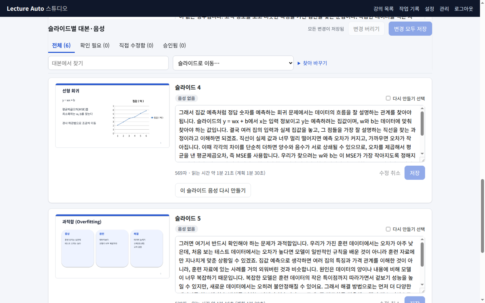
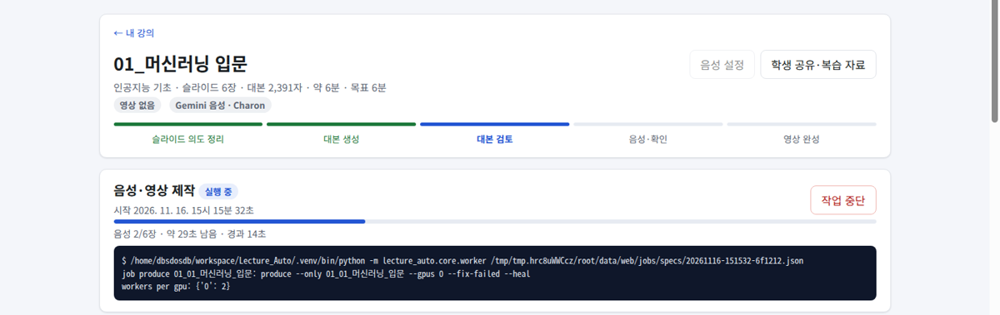
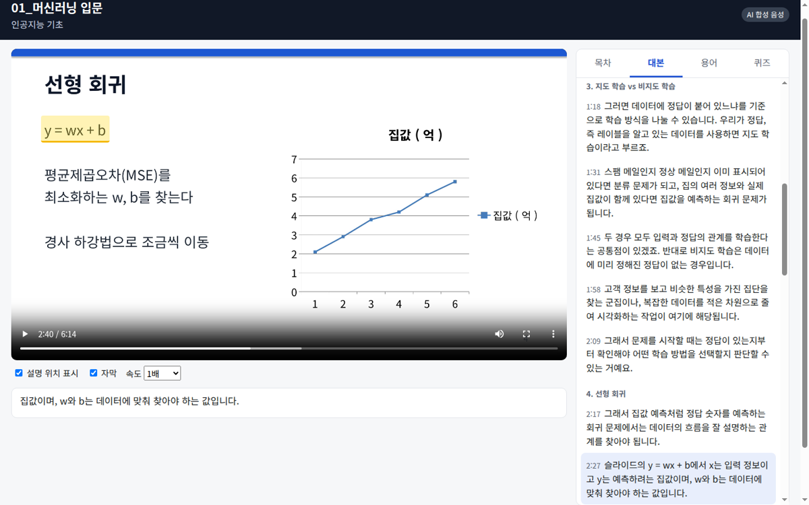
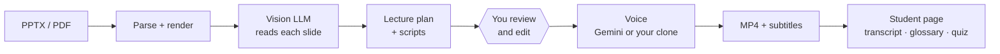

<div align="center">

# 🎓 Lecture Auto

### Drop in your slides. Get a narrated lecture video and a study page for your students.

Lecture Auto turns a PPTX/PDF deck into a **spoken lecture script you can edit**, **AI voice-over**
(hosted voices or **your own cloned voice**), an **MP4 with subtitles**, and a **shareable student page**
with a synced transcript, glossary and quiz. Self-hosted, multi-user, open source.

[](https://github.com/YUjinEDU/Lecture_Auto/actions/workflows/ci.yml)
[](https://github.com/YUjinEDU/Lecture_Auto/releases)
[](https://github.com/YUjinEDU/Lecture_Auto/pkgs/container/lecture-auto)
[](LICENSE)


[한국어](README.md) · **English**

[▶ Watch a sample lecture](https://github.com/YUjinEDU/Lecture_Auto/releases/download/v0.1.2/sample-lecture-ml-intro-ko.mp4) ·
[Quick start](#-quick-start) · [How it works](#-how-it-works) · [FAQ](#-faq)


</div>

---

## ✨ Why Lecture Auto?

Recording a lecture video costs hours for every hour of content: writing, rehearsing, re-recording each
stumble, editing, subtitling. Then students still ask for the slides, a transcript and practice questions.

Lecture Auto automates **how** a lecture gets produced and leaves **what** gets said to you:

- 📝 **You stay the author.** Every slide gets a plain-text script you can read, edit, search and replace,
  and approve. Hand-edited scripts and approved audio are never overwritten.
- 🗣️ **Natural narration.** Scripts are written as spoken lectures, not slide read-outs: they explain,
  give examples and connect one slide to the next, paced to the length you ask for.
- 🎬 **Finished output.** MP4, SRT/VTT subtitles, per-slide audio and the full transcript, ready to
  upload anywhere.
- 🧑‍🎓 **Built for students.** One revocable link gives them the video, a transcript that follows playback,
  a table of contents, a glossary and a quiz, with an "AI voice" label on the page.

## 🚀 Real numbers

Measured while making the sample lecture (6 slides, hosted Gemini voice, no GPU used):

| Step | Time |
|---|---|
| Lecture plan + scripts for 6 slides | **56 s** |
| Voice for every slide + video assembly | **≈ 31 s** |
| Result | **6 min 14 s** lecture MP4 with subtitles, 12 glossary terms, 8 quiz questions |

[▶ Watch the generated video](https://github.com/YUjinEDU/Lecture_Auto/releases/download/v0.1.2/sample-lecture-ml-intro-ko.mp4)
(narration in Korean).

## 🖼️ Screenshots

| Review and edit every slide's script | Live progress while voices are generated |
|---|---|
|  |  |

<details>
<summary>Student page (full size)</summary>



</details>

## 🧩 Features

**Understands your slides**
- PPTX and PDF input, rendered with LibreOffice, read by a vision LLM (text, tables, charts, figures)
- Lecture plan with sections and a time budget, plus optional memory of earlier lectures in the series

**Writes like a lecturer**
- Section-by-section scripts in spoken style, paced to your target length
- Optional *slide intent sheet*: state each slide's key message and time before scripts are written
- Optional *speaking-style profile* learned from your own lecture transcripts
- Optional *critic*: rewrites only weak slides and rejects rewrites that invent numbers or terms

**Speaks**
- Hosted voices: 30 Gemini voices through any OpenAI-compatible `/audio/speech` gateway, no GPU needed
- **Your own voice:** local cloning with Raon-Speech-9B on a GPU, allowed only with a recorded consent
- Pronunciation dictionary, loudness mastering, automatic quality checks, retry of failed slides

**Ships**
- MP4 assembly, SRT/VTT subtitles aligned to sentence timing, narration-synced slide highlights
- Downloads: video, subtitles, full script (TXT), per-slide audio (ZIP)
- Revocable student share links, professor-approved glossary and quiz, abuse reports

**Runs as a product**
- Multi-user web studio: accounts, closed / invite / open signup, encrypted per-user API keys,
  per-account quotas, admin screens
- Job queue that survives restarts, live progress and time remaining
- Reproducible: every artifact is cached by a hash of its inputs, so a re-run only redoes what changed

## 🔧 How it works



| Layer | Entry point |
|---|---|
| Web studio (FastAPI + plain JS) | `python -m lecture_auto.web` |
| Batch production CLI | `scripts/batch_generate_lectures.py`, `scripts/produce.py` |
| Interactive CLI | `run.py` |

## ⚡ Quick start

You need an API key for an OpenAI-compatible LLM endpoint (scripts and slide reading) and, for hosted
voices, a gateway that serves `gemini-3.8-flash-tts` at `/audio/speech`. No GPU required.

```bash
git clone https://github.com/YUjinEDU/Lecture_Auto.git && cd Lecture_Auto
cp .env.example .env     # set LECTURE_WEB_PASSWORD, OPENAI_API_KEY (or FACTCHAT_*),
                         # LLM_SCRIPT_MODEL / LLM_VLM_MODEL, and BAZE_API_KEY for voices
docker compose up -d
# open http://127.0.0.1:8800 and sign in as admin@local with LECTURE_WEB_PASSWORD
```

Or run the published image:

```bash
docker run -d --name lecture-auto -p 127.0.0.1:8800:8800 \
  --env-file .env -v "$PWD/docker-data:/data" ghcr.io/yujinedu/lecture-auto:latest
```

The image includes LibreOffice, poppler, ffmpeg and Korean fonts, and keeps all data in `/data`.
Put an HTTPS reverse proxy in front before you expose it (see [SECURITY.md](SECURITY.md)).

<details>
<summary><b>Local install, and GPU voice cloning</b></summary>

```bash
sudo apt install libreoffice-impress poppler-utils ffmpeg fonts-noto-cjk
uv sync --extra dev          # CPU: web, scripts, hosted voices
uv sync --all-extras         # CUDA 12.1 machine: adds Raon-Speech-9B voice cloning
LECTURE_WEB_PASSWORD=change-me uv run python -m lecture_auto.web --port 8800
```

</details>

<details>
<summary><b>Configuration</b></summary>

| Variable | Default | Purpose |
|---|---|---|
| `LECTURE_WEB_PASSWORD` | – | Password of the first admin (`admin@local`) on an empty database |
| `LECTURE_WEB_SIGNUP` | `closed` | `closed`, `invite` or `open` |
| `LECTURE_WEB_RAON` | `on` (`off` in Docker) | Local GPU voice cloning |
| `OPENAI_API_KEY` / `OPENAI_BASE_URL` | – | LLM for scripts and slide reading (any OpenAI-compatible API) |
| `FACTCHAT_API_KEY` / `FACTCHAT_BASE_URL` | – | Same; takes precedence over `OPENAI_*` |
| `LLM_SCRIPT_MODEL` / `LLM_VLM_MODEL` | gateway defaults | Model names for scripts / slide reading |
| `BAZE_API_KEY` / `BAZE_BASE_URL` | – | Hosted voices (`POST /audio/speech`) |
| `BAZE_TTS_TIMEOUT` | `30` | Seconds before a stalled voice request is retried |
| `LECTURE_WEB_KEY_BASE_URL` | BAZE gateway | Endpoint for API keys users register in Settings |
| `LECTURE_WEB_MAX_*`, `LECTURE_WEB_STORAGE_LIMIT_MB` | 30 lectures / 10 voices / 5 GB | Default per-account quotas |

Full reference: [`docs/WEB_UI.md`](docs/WEB_UI.md) · product guide: [`docs/PRODUCT_GUIDE.md`](docs/PRODUCT_GUIDE.md) ·
NAS deployment: [`docs/NAS_DEPLOY.md`](docs/NAS_DEPLOY.md)

</details>

## ❓ FAQ

**What language are the lectures in?**
Korean today: the script prompts produce spoken Korean, and the UI is Korean. Other languages are the top
item on the roadmap, and contributions are welcome.

**Do I need a GPU?**
No. Scripts, hosted voices and video run on a CPU server or a NAS. A GPU is only needed to clone your own
voice locally.

**Can it use my voice?**
Yes, with Raon-Speech-9B on a GPU. Each uploaded voice needs a recorded consent, and the model is licensed
for non-commercial use only (CC BY-NC 4.0).

**Will it overwrite my edits?**
No. Hand-edited scripts and approved audio are preserved. A re-run only regenerates what changed.

**Where does my data go?**
To your own server, plus the LLM and TTS endpoints you configure. Each user can bring their own API key,
stored encrypted.

## 🗺️ Roadmap

Ideas we'd love help with:

- [ ] English and other narration languages
- [ ] More voice providers (OpenAI TTS, ElevenLabs, local open models)
- [ ] One-click export to LMS platforms (Moodle, Canvas)
- [ ] Slide-level video clips and chaptered YouTube export

Have an idea? [Open an issue](https://github.com/YUjinEDU/Lecture_Auto/issues/new/choose).

## 🤝 Contributing

```bash
uv sync --extra dev
uv run pytest -q     # 700+ tests, no GPU, network or API key needed
uvx ruff check .
```

See [CONTRIBUTING.md](CONTRIBUTING.md). Issues and PRs are welcome in English or Korean.

## 📄 License

Code: [MIT](LICENSE). **Models are licensed separately:** Raon-Speech-9B (optional local voice cloning) is
CC BY-NC 4.0, non-commercial use only, and hosted LLM/TTS providers have their own terms. Clone a voice
only with the speaker's documented consent.

<div align="center">

**If Lecture Auto saves you a recording session, please ⭐ the repo. It helps other teachers find it.**

[](https://star-history.com/#YUjinEDU/Lecture_Auto&Date)

</div>
