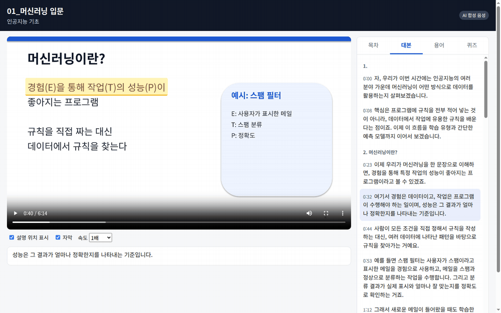
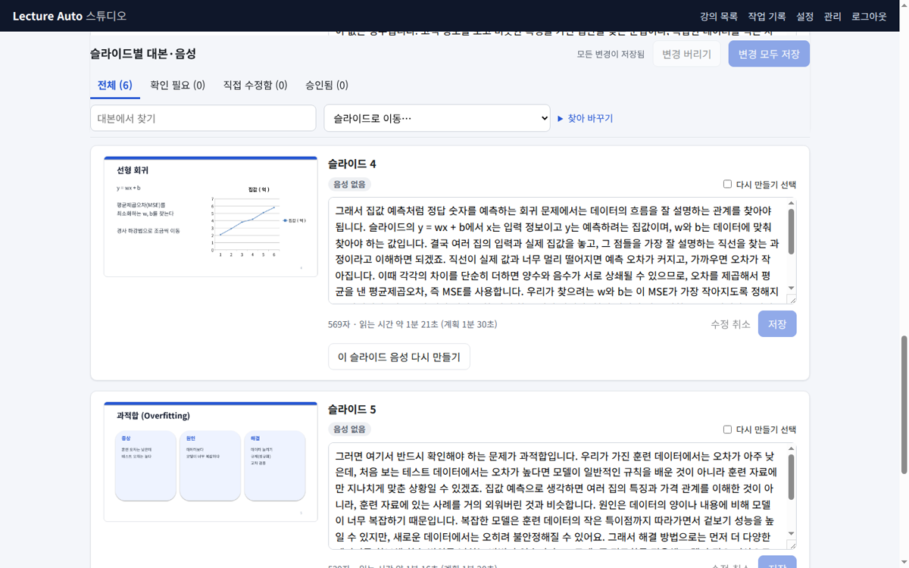
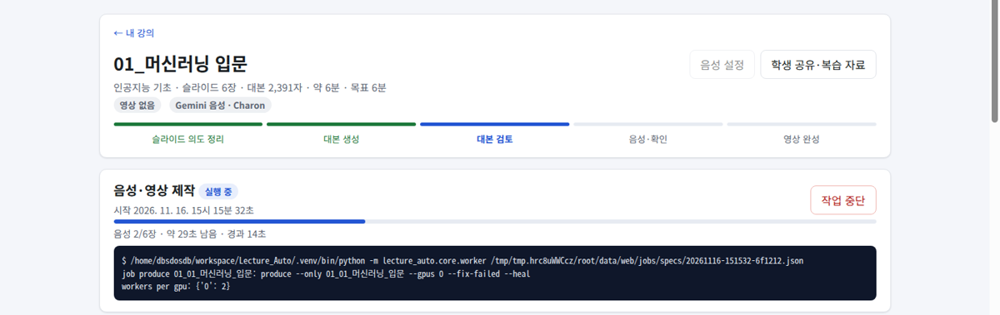
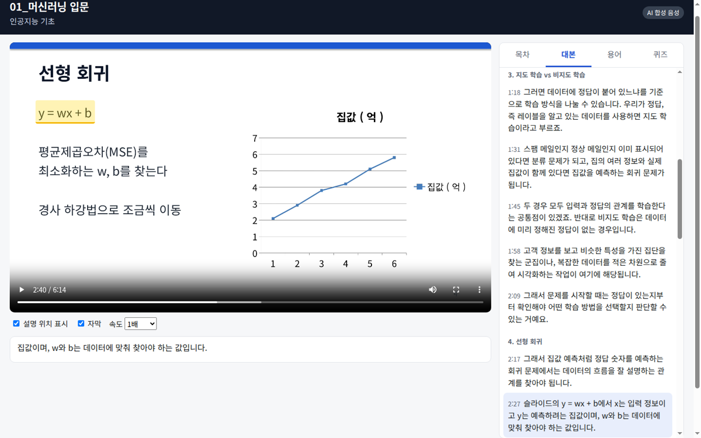
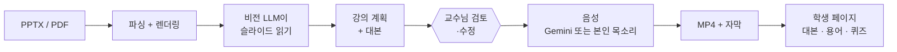

<div align="center">

# 🎓 Lecture Auto

### 슬라이드만 올리세요. 강의 영상과 학생용 복습 페이지가 나옵니다.

Lecture Auto는 PPTX/PDF 강의자료로 **직접 고칠 수 있는 강의 대본**, **AI 음성**(기본 음성 또는
**교수님 본인 목소리 복제**), **자막이 들어간 MP4**, 그리고 대본·용어·퀴즈가 함께 있는 **학생 공유 페이지**를
만듭니다. 직접 설치해 여러 사용자가 함께 쓰는 오픈소스입니다.

[](https://github.com/YUjinEDU/Lecture_Auto/actions/workflows/ci.yml)
[](https://github.com/YUjinEDU/Lecture_Auto/releases)
[](https://github.com/YUjinEDU/Lecture_Auto/pkgs/container/lecture-auto)
[](LICENSE)


[English](README.md) · **한국어**

[▶ 샘플 강의 보기](https://github.com/YUjinEDU/Lecture_Auto/releases/download/v0.1.2/sample-lecture-ml-intro-ko.mp4) ·
[빠른 시작](#-빠른-시작) · [동작 방식](#-동작-방식) · [자주 묻는 질문](#-자주-묻는-질문)



<sub>슬라이드 6장으로 Lecture Auto가 만든 학생 페이지입니다. 지금 설명하는 부분이 강조되고, 대본이 재생 위치를
따라가며, 용어와 퀴즈는 대본에서 만들어집니다.</sub>

</div>

---

## ✨ 왜 Lecture Auto인가요?

강의 영상 한 시간을 만들려면 몇 시간이 듭니다. 대본을 쓰고, 연습하고, 말이 꼬일 때마다 다시 녹음하고,
편집하고, 자막까지 달아야 합니다. 그래도 학생들은 슬라이드와 대본, 연습 문제를 또 찾습니다.

Lecture Auto는 **어떻게 만들지**를 자동화하고, **무엇을 말할지**는 교수님께 맡깁니다.

- 📝 **대본의 주인은 교수님입니다.** 슬라이드마다 일반 텍스트 대본이 생기고, 읽고 고치고 찾아 바꾸고
  승인할 수 있습니다. 직접 고친 대본과 승인한 음성은 절대 덮어쓰지 않습니다.
- 🗣️ **읽는 게 아니라 강의합니다.** 슬라이드를 그대로 읽지 않고, 설명하고 예를 들고 다음 장으로 자연스럽게
  이어 가는 구어체 대본을 원하는 강의 길이에 맞춰 씁니다.
- 🎬 **바로 쓰는 결과물.** MP4 영상, SRT/VTT 자막, 슬라이드별 음성, 전체 대본을 내려받아 어디에든 올릴 수 있습니다.
- 🧑‍🎓 **학생을 위한 페이지.** 회수할 수 있는 링크 하나로 영상, 재생을 따라가는 대본, 목차, 용어, 퀴즈를
  제공합니다. 페이지에는 "AI 합성 음성" 표시가 붙습니다.

## 🚀 실제로 재 본 시간

위 데모 기준(슬라이드 6장, Gemini 음성, GPU 사용 안 함)입니다.

| 단계 | 걸린 시간 |
|---|---|
| 강의 계획 + 슬라이드 6장 대본 | **56초** |
| 모든 슬라이드 음성 + 영상 조립 | **약 31초** |
| 결과 | 자막이 들어간 **6분 14초** 강의 영상, 용어 12개, 퀴즈 8문제 |

[▶ 만들어진 영상 보기](https://github.com/YUjinEDU/Lecture_Auto/releases/download/v0.1.2/sample-lecture-ml-intro-ko.mp4)

## 🖼️ 화면

| 슬라이드별 대본 검토·수정 | 음성 제작 진행률과 남은 시간 |
|---|---|
|  |  |

<details>
<summary>학생 페이지 (원본 크기)</summary>



</details>

## 🧩 기능

**슬라이드를 이해합니다**
- PPTX·PDF 입력, LibreOffice로 렌더링, 비전 LLM이 글자·표·차트·그림까지 읽기
- 섹션별 강의 계획과 시간 배분, (선택) 앞선 강의 내용을 이어 받는 시리즈 기억

**강의하듯 씁니다**
- 섹션 단위의 구어체 대본, 목표 강의 길이에 맞춘 분량
- (선택) **슬라이드 의도 시트**: 대본을 쓰기 전에 장마다 전할 핵심과 시간을 먼저 정하기
- (선택) **교수님 말투 프로필**: 직접 하신 강의 녹취록에서 말투를 뽑아 반영
- (선택) **대본 다듬기**: 약한 슬라이드만 다시 쓰고, 숫자나 용어를 지어내면 채택하지 않기

**말합니다**
- 기본 음성: OpenAI 호환 `/audio/speech` 게이트웨이로 Gemini 음성 30종, GPU 필요 없음
- **교수님 목소리:** GPU에서 Raon-Speech-9B로 음성 복제, 동의 기록이 있는 음성만 허용
- 발음 사전, 음량 마스터링, 자동 품질 검사, 실패한 슬라이드 자동 복구

**완성합니다**
- MP4 조립, 문장 시각에 맞춘 SRT/VTT 자막, 설명 위치를 따라가는 슬라이드 강조
- 내려받기: 영상, 자막, 전체 대본(TXT), 슬라이드별 음성(ZIP)
- 회수 가능한 학생 공유 링크, 교수자가 승인한 용어·퀴즈, 신고 기능

**제품으로 운영합니다**
- 여러 사용자용 웹 스튜디오: 계정, 가입 방식(closed / invite / open), 사용자별 암호화 API 키,
  계정별 사용량 한도, 관리자 화면
- 서버를 다시 켜도 이어지는 작업 큐, 실시간 진행률과 남은 시간
- 재현 가능: 모든 산출물을 입력 해시로 캐시해서, 다시 돌리면 바뀐 부분만 새로 만듭니다

## 🔧 동작 방식



| 구성 | 실행 |
|---|---|
| 웹 스튜디오 (FastAPI + 순수 JS) | `python -m lecture_auto.web` |
| 일괄 제작 CLI | `scripts/batch_generate_lectures.py`, `scripts/produce.py` |
| 대화형 CLI | `run.py` |

## ⚡ 빠른 시작

대본 생성과 슬라이드 읽기에 쓸 OpenAI 호환 LLM API 키가 필요하고, 기본 음성을 쓰려면
`gemini-3.8-flash-tts`를 `/audio/speech`로 제공하는 게이트웨이 키가 필요합니다. GPU는 필요 없습니다.

```bash
git clone https://github.com/YUjinEDU/Lecture_Auto.git && cd Lecture_Auto
cp .env.example .env     # LECTURE_WEB_PASSWORD, OPENAI_API_KEY(또는 FACTCHAT_*),
                         # LLM_SCRIPT_MODEL / LLM_VLM_MODEL, 음성용 BAZE_API_KEY 입력
docker compose up -d
# 브라우저에서 http://127.0.0.1:8800 → admin@local / LECTURE_WEB_PASSWORD 로 로그인
```

미리 만들어 둔 이미지로 바로 실행할 수도 있습니다.

```bash
docker run -d --name lecture-auto -p 127.0.0.1:8800:8800 \
  --env-file .env -v "$PWD/docker-data:/data" ghcr.io/yujinedu/lecture-auto:latest
```

이미지에는 LibreOffice, poppler, ffmpeg, 한글 글꼴이 들어 있고, 모든 데이터는 `/data`에 쌓입니다.
외부에 공개하기 전에 HTTPS 리버스 프록시를 앞에 두세요([SECURITY.md](SECURITY.md) 참고).

<details>
<summary><b>직접 설치, 그리고 GPU 음성 복제</b></summary>

```bash
sudo apt install libreoffice-impress poppler-utils ffmpeg fonts-noto-cjk
uv sync --extra dev          # CPU: 웹, 대본, 기본 음성
uv sync --all-extras         # CUDA 12.1 서버: Raon-Speech-9B 음성 복제 추가
LECTURE_WEB_PASSWORD=change-me uv run python -m lecture_auto.web --port 8800
```

NAS(Synology)에 설치하는 방법은 [`docs/NAS_DEPLOY.md`](docs/NAS_DEPLOY.md)를 보세요.

</details>

<details>
<summary><b>설정</b></summary>

| 변수 | 기본값 | 용도 |
|---|---|---|
| `LECTURE_WEB_PASSWORD` | – | 빈 DB에서 처음 만드는 관리자(`admin@local`) 비밀번호 |
| `LECTURE_WEB_SIGNUP` | `closed` | `closed`, `invite`, `open` |
| `LECTURE_WEB_RAON` | `on` (Docker는 `off`) | GPU 음성 복제 사용 |
| `OPENAI_API_KEY` / `OPENAI_BASE_URL` | – | 대본·슬라이드 읽기용 LLM (OpenAI 호환이면 무엇이든) |
| `FACTCHAT_API_KEY` / `FACTCHAT_BASE_URL` | – | 같은 용도, `OPENAI_*`보다 우선 |
| `LLM_SCRIPT_MODEL` / `LLM_VLM_MODEL` | 게이트웨이 기본값 | 대본 / 슬라이드 읽기 모델 이름 |
| `BAZE_API_KEY` / `BAZE_BASE_URL` | – | 기본 음성 (`POST /audio/speech`) |
| `BAZE_TTS_TIMEOUT` | `30` | 응답이 멈춘 음성 요청을 다시 보내기까지 기다리는 초 |
| `LECTURE_WEB_KEY_BASE_URL` | BAZE 게이트웨이 | 사용자가 설정에 등록한 API 키를 보낼 주소 |
| `LECTURE_WEB_MAX_*`, `LECTURE_WEB_STORAGE_LIMIT_MB` | 강의 30개 / 음성 10개 / 5GB | 계정별 기본 한도 |

전체 설명: [`docs/WEB_UI.md`](docs/WEB_UI.md) · 기능 안내: [`docs/PRODUCT_GUIDE.md`](docs/PRODUCT_GUIDE.md)

</details>

## ❓ 자주 묻는 질문

**어떤 언어로 강의하나요?**
지금은 한국어입니다. 대본 프롬프트가 한국어 구어체로 쓰도록 되어 있고 화면도 한국어입니다.
다른 언어 지원은 로드맵의 첫 번째 항목이고, 기여를 환영합니다.

**GPU가 꼭 있어야 하나요?**
아니요. 대본, 기본 음성, 영상은 일반 서버나 NAS에서 돌아갑니다. 본인 목소리를 직접 복제할 때만 GPU가 필요합니다.

**제 목소리로 만들 수 있나요?**
네, GPU에서 Raon-Speech-9B로 가능합니다. 올리는 음성마다 동의 기록이 있어야 하고, 이 모델은
비상업 용도(CC BY-NC 4.0)로만 쓸 수 있습니다.

**제가 고친 대본이 덮어써지지 않나요?**
덮어쓰지 않습니다. 직접 고친 대본과 승인한 음성은 그대로 두고, 다시 돌리면 바뀐 부분만 새로 만듭니다.

**데이터는 어디로 가나요?**
설치한 서버와, 설정한 LLM·음성 API로만 갑니다. 사용자마다 자기 API 키를 등록할 수 있고 키는 암호화해 보관합니다.

## 🗺️ 로드맵

함께 만들고 싶은 기능입니다.

- [ ] 영어 등 다른 언어 강의
- [ ] 더 많은 음성 엔진 (OpenAI TTS, ElevenLabs, 로컬 공개 모델)
- [ ] LMS(Moodle, Canvas)로 바로 내보내기
- [ ] 슬라이드별 영상 클립과 챕터가 있는 YouTube 내보내기

아이디어가 있으면 [이슈로 알려 주세요](https://github.com/YUjinEDU/Lecture_Auto/issues/new/choose).

## 🤝 기여하기

```bash
uv sync --extra dev
uv run pytest -q     # 테스트 700여 개, GPU·네트워크·API 키 없이 실행
uvx ruff check .
```

[CONTRIBUTING.md](CONTRIBUTING.md)를 참고해 주세요. 이슈와 PR은 한국어로도 영어로도 좋습니다.

## 📄 라이선스

코드는 [MIT](LICENSE)입니다. **모델 라이선스는 따로입니다.** 선택 기능인 Raon-Speech-9B(로컬 음성 복제)는
CC BY-NC 4.0이라 비상업 용도로만 쓸 수 있고, 외부 LLM·음성 서비스는 각자의 약관을 따릅니다.
목소리 복제는 본인 동의가 기록된 음성으로만 하세요.

<div align="center">

**녹화 한 번이라도 줄여 드렸다면 ⭐ Star로 응원해 주세요. 다른 선생님들이 이 프로젝트를 찾는 데 큰 도움이 됩니다.**

[](https://star-history.com/#YUjinEDU/Lecture_Auto&Date)

</div>
