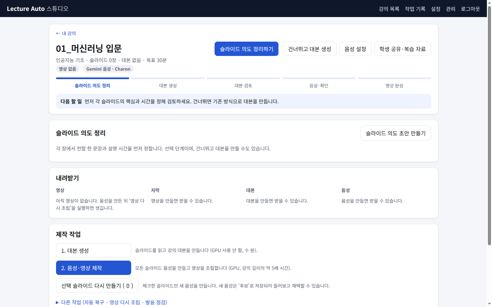

<div align="center">

# 🎓 Lecture Auto

**Slides in, finished lecture out.**
Turn a PPTX/PDF deck into a reviewable lecture script, natural voice-over, subtitles and an MP4 —
then share it with students as an interactive study page.

**슬라이드를 넣으면 강의가 나옵니다.** PPTX/PDF 강의자료로 슬라이드별 강의 대본·음성·자막·영상을 만들고,
교수자가 대본을 직접 검수·수정한 뒤 학생용 복습 페이지로 공유합니다.

[](https://github.com/YUjinEDU/Lecture_Auto/actions/workflows/ci.yml)
[](https://github.com/YUjinEDU/Lecture_Auto/pkgs/container/lecture-auto)
[](LICENSE)


[English](#english) · [한국어](#한국어) · [Quick start](#-quick-start-docker) · [Docs](docs/)



</div>

---

## English

### Why

Recording a lecture video takes hours per hour of content: writing, rehearsing, re-recording every
mistake. Lecture Auto keeps the professor in charge of **what is said** (plain-text scripts you can
edit) while automating **how it is produced** (voice, timing, subtitles, video, student page).

### Features

- **Slide understanding** — PPTX and PDF parsing, LibreOffice rendering, vision-LLM notes per slide
  (tables, figures, equations).
- **Lecture-quality scripts** — section-level planning with series memory across lectures,
  pacing targets per slide, optional professor *style profile* learned from your own transcripts,
  and an optional critic that only rewrites weak slides behind strict factual gates
  (no invented numbers or terms).
- **Human-in-the-loop review** — per-slide script editor with find & replace, revert, bulk save,
  approve / unapprove, regenerate-one-slide; hand-edited scripts are never overwritten.
- **Voice** — hosted TTS (Gemini via any OpenAI-compatible `/audio/speech` gateway, 30 voices)
  or local voice cloning with Raon-Speech-9B on a GPU (consent record required per voice).
  Pronunciation dictionary, loudness mastering, automatic quality gates.
- **Video & subtitles** — MP4 assembly with ffmpeg, SRT/VTT subtitles aligned to sentence timing,
  slide highlights that follow the narration.
- **Student page** — revocable share link with video, synced transcript, table of contents,
  speed control, professor-approved glossary & quiz, "AI voice" disclosure and abuse reports.
- **Multi-user web studio** — accounts (scrypt), closed / invite / open signup, per-user encrypted
  API keys, admin quotas, serial job queue that survives restarts.
- **Reproducible** — every artifact is cached by SHA-256 of its inputs; the same deck and settings
  re-run to the same result.

### How it works

```text
PPTX/PDF ─▶ parse ─▶ render PNG ─▶ vision notes ─▶ lecture plan ─▶ scripts ─┐
                                                                             ▼
   student page ◀── MP4 + subtitles ◀── mastering ◀── TTS ◀── professor review/approve
```

| Layer | Entry point |
|---|---|
| Web studio (FastAPI + static UI) | `python -m lecture_auto.web` |
| Batch production CLI | `scripts/batch_generate_lectures.py`, `scripts/produce.py` |
| Interactive CLI | `run.py` |

### 🚀 Quick start (Docker)

No GPU needed. You need an OpenAI-compatible API key for script generation.

```bash
git clone https://github.com/YUjinEDU/Lecture_Auto.git && cd Lecture_Auto
cp .env.example .env        # set LECTURE_WEB_PASSWORD, OPENAI_API_KEY (or FACTCHAT_*)
                            # and LLM_SCRIPT_MODEL / LLM_VLM_MODEL for plain OpenAI
docker compose up -d        # builds the image on first run
# then browse http://127.0.0.1:8800 and log in as admin@local with LECTURE_WEB_PASSWORD
```

Or use the prebuilt image:

```bash
docker run -d --name lecture-auto -p 127.0.0.1:8800:8800 \
  --env-file .env -v "$PWD/docker-data:/data" ghcr.io/yujinedu/lecture-auto:latest
```

The image bundles LibreOffice, poppler, ffmpeg and Korean fonts. Data lives in `/data`.
Put an HTTPS reverse proxy in front before exposing it (see [SECURITY.md](SECURITY.md)).

### Local install (development / GPU voice cloning)

```bash
sudo apt install libreoffice-impress poppler-utils ffmpeg fonts-noto-cjk
uv sync --extra dev                 # CPU: web, scripts, hosted TTS
uv sync --all-extras                # CUDA 12.1 box: adds Raon-Speech-9B voice cloning
LECTURE_WEB_PASSWORD=change-me uv run python -m lecture_auto.web --port 8800
```

### Configuration

| Variable | Default | Purpose |
|---|---|---|
| `LECTURE_WEB_PASSWORD` | — | Password of the first admin (`admin@local`) on an empty database |
| `LECTURE_WEB_SIGNUP` | `closed` | `closed`, `invite` or `open` |
| `LECTURE_WEB_RAON` | `on` (`off` in Docker) | Enable local GPU voice cloning |
| `OPENAI_API_KEY` / `OPENAI_BASE_URL` | — | LLM for scripts and slide vision (any OpenAI-compatible API) |
| `FACTCHAT_API_KEY` / `FACTCHAT_BASE_URL` | — | Same, takes precedence over `OPENAI_*` |
| `LLM_SCRIPT_MODEL` / `LLM_VLM_MODEL` | gateway defaults | Model names for scripts / vision |
| `BAZE_API_KEY` / `BAZE_BASE_URL` | — | Hosted TTS (`POST /audio/speech`) |
| `LECTURE_WEB_KEY_BASE_URL` | BAZE gateway | Endpoint for API keys users register in Settings |
| `LECTURE_WEB_MAX_*`, `LECTURE_WEB_STORAGE_LIMIT_MB` | 30 lectures / 10 voices / 5 GB | Default per-account quotas |

Full reference: [`docs/WEB_UI.md`](docs/WEB_UI.md) · product guide: [`docs/PRODUCT_GUIDE.md`](docs/PRODUCT_GUIDE.md) ·
NAS deployment: [`docs/NAS_DEPLOY.md`](docs/NAS_DEPLOY.md).

### Development

```bash
uv run pytest -q     # 700+ tests, no GPU / network / API key needed
uvx ruff check .
```

See [CONTRIBUTING.md](CONTRIBUTING.md). Issues and PRs welcome in English or Korean.

### License

Code: [MIT](LICENSE). **Models are licensed separately**: Raon-Speech-9B (optional local voice
cloning) is CC BY-NC 4.0 — non-commercial use only. Hosted LLM/TTS providers have their own terms.
Only clone a voice with the speaker's documented consent; generated audio is labeled as AI voice
on the student page.

---

## 한국어

### 무엇을 하나요

- **슬라이드 이해**: PPTX·PDF를 파싱하고 렌더링한 뒤, 비전 LLM이 슬라이드별 표·그림·수식 메모를 만듭니다.
- **강의 대본**: 강의 시리즈 기억, 슬라이드별 목표 시간, (선택) 교수님 녹취록에서 뽑은 **말투 프로필**,
  (선택) 약한 슬라이드만 다시 쓰는 **대본 다듬기** — 숫자·용어를 지어내면 채택하지 않습니다.
- **교수자 검수**: 슬라이드별 대본 편집, 찾아 바꾸기, 되돌리기, 일괄 저장, 승인/취소, 한 장만 다시 만들기.
  직접 고친 대본은 덮어쓰지 않습니다.
- **음성**: Gemini TTS(OpenAI 호환 게이트웨이, 기본 음성 30종) 또는 GPU에서 Raon-Speech-9B 음성 복제(동의 기록 필수).
  발음 사전, 음량 마스터링, 자동 품질 검사.
- **영상·자막·학생 페이지**: MP4 조립, 문장 시각에 맞춘 SRT/VTT 자막, 설명 위치 하이라이트,
  회수 가능한 공유 링크(영상·대본 따라 읽기·목차·용어·퀴즈·신고).
- **여러 사용자**: 계정, 가입 모드(closed/invite/open), 사용자별 암호화 API 키, 관리자 용량 제한, 재시작에도 살아남는 작업 큐.

### 빠른 시작

```bash
git clone https://github.com/YUjinEDU/Lecture_Auto.git && cd Lecture_Auto
cp .env.example .env        # LECTURE_WEB_PASSWORD, OPENAI_API_KEY(또는 FACTCHAT_*), 모델명(LLM_SCRIPT_MODEL 등) 입력
docker compose up -d
# 브라우저에서 http://127.0.0.1:8800 → admin@local / LECTURE_WEB_PASSWORD 로 로그인
```

GPU 음성 복제는 CUDA 서버에서 `uv sync --all-extras` 후 `python -m lecture_auto.web`으로 실행합니다.
자세한 내용은 [`docs/WEB_UI.md`](docs/WEB_UI.md), [`docs/PRODUCT_GUIDE.md`](docs/PRODUCT_GUIDE.md)를 보세요.

### 라이선스

코드는 MIT입니다. 선택 기능인 Raon-Speech-9B 모델은 CC BY-NC 4.0(비상업 전용)입니다.
목소리 복제는 본인 동의가 기록된 음성으로만 하세요.

⭐ 도움이 되셨다면 Star로 응원해 주세요!
